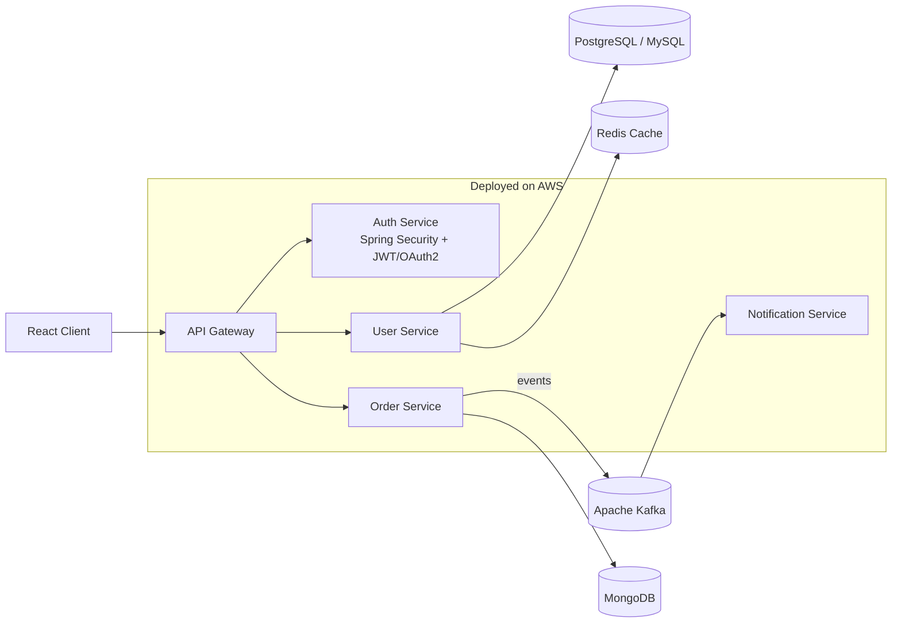

<!-- 
  HOW TO USE:
  1. Create a public repo named exactly the same as your GitHub username.
  2. Add this file as README.md in that repo.
  3. Replace every YOUR_USERNAME, YOUR_NAME, and link placeholder.
-->

<h1 align="center">Hi, I'm GOVINDA EKABOTE 👋</h1>

<h3 align="center">Java Backend Developer | Microservices | Spring Boot | Cloud</h3>

  

  
  
  
  

---

## 👨‍💻 About Me

I'm a **Java Developer** who enjoys designing and building reliable, secure, and scalable backend systems. I work across the full development lifecycle, from architecture and API design to containerized deployment on the cloud, with a strong focus on clean code, SOLID principles, and performance.

- 🔭 Building **microservices** with Spring Boot, Spring Cloud, Kafka, and Redis
- 🔐 Implementing **secure systems** using Spring Security, JWT, OAuth 2.0, and RBAC
- ⚡ Optimizing **database performance** through SQL tuning and indexing
- 🤖 Exploring **AI-powered applications** with Spring AI
- ☁️ Deploying with **Docker, Kubernetes, AWS, and CI/CD pipelines**
- 🤝 Working in **Agile/Scrum** teams with cross-functional collaboration

---

## 🛠️ Tech Stack

  

### 🧠 Programming & Core Java

### ⚙️ Backend Development & Frameworks

### 🎨 Frontend Development

### 🗄️ Databases & Data Management

### 🧩 Microservices & Messaging

### 🔐 Security & Authentication

### 🧪 Testing, Debugging & API Documentation

### ☁️ Cloud & AWS

### 🚀 DevOps & Development Tools

### 📐 Software Engineering & Methodologies

### 🤝 Engineering & Collaboration
`Problem-Solving` · `Analytical Skills` · `Critical Thinking` · `Teamwork` · `Cross-Functional Collaboration` · `Attention to Detail`

---

## 🏗️ Typical Architecture I Work With

---

## 📌 Featured Projects

> Replace the entries below with your own projects.

| Project | Description | Tech |
|---|---|---|
| 🔗 [**Airline Managment System**](https://github.com/GovindaEkabote/Airline-Managment-System-) | Microservices-based Airline Managment System with event-driven order processing | `Java 17` `Spring Boot` `Kafka` `Redis` `Docker` `FeignClient` `MySql` `Microservices` `Spring Security` `JWT` `OAuth 2.0` `Swagger`| ,
| 🔗 [**NETFLIX AI-POWERED VIDEO STREAMING PLATFORM**](https://github.com/GovindaEkabote/NetFlix) | Secure REST API with JWT auth, RBAC, and Swagger documentation | `Java 17` `Spring Boot` `Kafka` `Redis` `Docker` `FeignClient` `MySql` `Microservices` `Spring Security` `JWT` `OAuth 2.0` `Swagger` `Ollama` `LLM` |
| 🔗 [**AI HELP DESK WITH AI ADVISOR**](https://github.com/GovindaEkabote/IT-Help-Desk-With-AI-Advisor) | AI-powered assistant integrated into a Spring backend |`Java 17` `Spring Boot` `Kafka` `Redis` `Docker` `FeignClient` `MySql` `Microservices` `Spring Security` `JWT` `OAuth 2.0` `Swagger` `Ollama` `LLM` |
| 🔗 [**PayFlux**](https://github.com/GovindaEkabote/PayFlux) | CI/CD pipeline with containerized deployment to Kubernetes on AWS | `Docker` `Kubernetes` `GitLab CI` `AWS EC2` |

---

## 📊 GitHub Stats

  
  

  

  

---

## 🎯 Currently

- 📚 Deepening knowledge of **distributed systems** and **event-driven design**
- 🧠 Experimenting with **Spring AI** and LLM integrations
- 🛠️ Improving **observability and CI/CD** practices for microservices

---

## 🤝 Let's Connect

I'm open to collaboration, backend engineering opportunities, and discussions around Java, Spring, and system design.

  
  

<i>"Clean code always looks like it was written by someone who cares."</i> ☕

  

